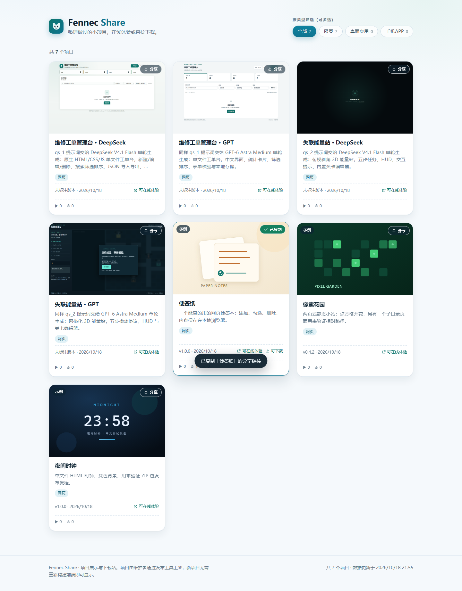

# Fennec Share · 项目分享站

把做过的小项目摆出来：能在线试玩的直接玩，能下载的直接下。

- 本地开发：<http://127.0.0.1:5173/>（`npm run dev`，带热更新）/ <http://127.0.0.1:8787/>（`npm start`，生产模式）
- 服务器：已部署为 `fennec-share.service`，监听 `127.0.0.1:8770`（Ubuntu 24.04 + Node 24 LTS + systemd）
- 公网域名：`https://share.fennecmomo.top` —— **尚未映射**，需要先在 Cloudflare 仪表盘加一条
  Public Hostname 指到 `http://localhost:8770`，步骤见 [docs/DEPLOYMENT.md](docs/DEPLOYMENT.md) 第五节



## 这是什么

一个单进程的 Node 站点 + 一个发布 CLI：

- **访客**看到卡片列表，可以按类型多选筛选，点开卡片看截图、介绍、在线体验和下载。
- **维护者**（你或 Hermes）用发布 CLI 把一个目录 / ZIP / EXE / APK 变成线上的一个项目，**不需要重新构建前端**。
- 数据全部落在磁盘上的一个 JSON 加一堆静态文件里，没有数据库、没有对象存储、没有 Docker。

## 功能

| 能力 | 实现方式 |
| --- | --- |
| 卡片列表 | CSS Grid 自适应列数，图片懒加载，缺图自动回落占位图 |
| 类型筛选 | 全部 / 网页 / 桌面应用 / 手机APP，多选为 OR，按钮上带实时计数 |
| 项目详情 | 原生 `<dialog>`：焦点陷阱、Esc 关闭、点遮罩关闭、关闭后焦点回到原卡片、打开时锁背景滚动 |
| 截图浏览 | 多图切换（缩略图 / 左右箭头 / 方向键 / 计数器），单图损坏不影响其它图 |
| 在线试玩 | `/play/<slug>/` 稳定入口 → 302 到当前版本的独立目录，静态资源按内容不可变长缓存 |
| 下载 | 流式输出，支持 `Range` / `HEAD` / `ETag` / `Last-Modified`，`Content-Disposition` 正确处理中文与空格，catalog 里带 SHA-256 |
| 分享 | 每张卡片右上角「分享」按钮：复制带 ?p=<slug> 的链接，对方打开后自动弹出该项目并同步地址栏 |
| 状态处理 | 首次加载骨架屏、接口失败 + 重试、空列表、筛选无结果；发布后刷新页面即见新内容，无需重启 |
| 安全 | 站点页面带 CSP 与 `X-Frame-Options: DENY`；试玩内容不套 CSP（否则大量现成页面会挂）；路径穿越、未登记文件、`.catalog.json` 一律 404 |
| 发布 | 校验、暂存、原子替换 catalog、写锁、幂等、历史快照、回滚、下架、备份恢复 |
| 管理后台 | /admin 密码登录：改项目信息、上传封面/截图、改密码；复用发布事务（加锁 + 原子换 catalog + 保留旧版本） |

## 快速开始

需要 Node.js **>= 22.12**（Vite 7 的要求，项目 `engines` 已声明）。

```bash
npm ci                 # 安装锁定依赖
npm run dev            # 开发模式：API(8787) + Vite(5173)，带 /api /play /download 代理
npm run build          # 类型检查 + 构建前端到 dist/web + 构建服务端到 dist/server
npm start              # 生产模式，默认 http://127.0.0.1:8787/
npm run seed:demo      # 导入 3 个示例项目（都带「示例」标记）
npm run selftest       # 48 项集成自测：发布事务 + 真实 HTTP 断言 + 管理接口
npm run verify         # build + selftest 一条龙
```

Windows 上如果 `npm` 被 PowerShell 执行策略拦住，用 `npm.cmd`。

## 目录结构

```
server/             Express 服务端（路由、静态、流式下载、catalog 缓存、管理接口与鉴权）
src/                React 前端（首页、筛选、卡片、详情弹窗）+ src/admin 管理页面
shared/             前后端共用的类型与 catalog 校验
tools/              发布 CLI（publish.ts + lib/*）与自测
demo/               示例项目：真实可交互的静态包 + manifest
deploy/             systemd 单元模板、部署脚本、env 示例
docs/               架构 / 部署 / 发布指南 / 包规范 / 验证报告
data/               运行期数据（git 忽略）：catalog.json + projects/ + staging/ + backups/
```

## 发布一个项目

最小 manifest（`my-tool/manifest.json`）：

```json
{
  "slug": "my-tool",
  "title": "我的小工具",
  "summary": "一句话说明它做什么。",
  "categories": ["desktop"],
  "downloads": [
    { "fileName": "MyTool-1.0.0.exe", "path": "dist/MyTool-1.0.0.exe", "platform": "windows", "version": "1.0.0", "default": true }
  ]
}
```

```bash
DATA_DIR=/srv/fennec-share/data node dist/tools/publish.js publish --manifest /绝对路径/my-tool/manifest.json
```

- 网页包用 `web.package`（ZIP）或 `web.directory`（目录）。
- 一个项目可以同时有网页、EXE、APK，互不影响；只更新其中一个不会删掉其它。
- 详细字段、限额、错误码见 [docs/HERMES_PUBLISH_GUIDE.md](docs/HERMES_PUBLISH_GUIDE.md)；
  打包 HTML 的注意事项见 [docs/HTML_PACKAGE_GUIDE.md](docs/HTML_PACKAGE_GUIDE.md)。

## URL 约定

| 地址 | 行为 |
| --- | --- |
| `/` | 站点首页 |
| `/play/<slug>/` | 稳定试玩入口，302 到 `/play/<slug>/r/<releaseId>/` |
| `/play/<slug>/<子路径>` | 同上，重定向到当前版本的同名子路径（深层链接可分享） |
| `/play/<slug>/r/<releaseId>/...` | 版本目录，长缓存；刷新、直接访问都可用 |
| `/download/<slug>/<文件名>` | 单文件下载；未登记的文件名 404 |
| `/download/<slug>` | 只有一个（或指定了默认）文件时 302，多文件且无默认时 409 并列出可选项 |
| `/media/<slug>/r/<releaseId>/<文件>` | 封面/截图，只暴露 catalog 里登记过的图片 |
| `/api/projects` | 公开项目列表（不含内部存储路径） |
| `/healthz` | 健康检查（含 catalog 版本与项目计数） |

## 常用命令

```bash
node dist/tools/publish.js list                       # 看已发布项目
node dist/tools/publish.js validate --manifest <文件>  # 只校验，不写盘
node dist/tools/publish.js publish --manifest <文件> --dry-run
node dist/tools/publish.js unpublish --slug <slug>     # 下架，文件保留
node dist/tools/publish.js rollback --slug <slug>      # 回到上一个状态
node dist/tools/publish.js history --slug <slug>       # 看历史状态
node dist/tools/publish.js backup --out <目录>          # 备份 catalog + 全部文件
node dist/tools/publish.js restore --from <备份目录> --dry-run
node dist/tools/publish.js cleanup                     # 清理 staging 残留
```

全部命令都支持 `--json`，退出码 0 成功 / 1 失败 / 2 输入不合法。

## 管理后台

浏览器打开 `/admin`（生产就是 `https://share.fennecmomo.top/admin`）即可管理项目，不需要另开服务。

| 能力 | 说明 |
| --- | --- |
| 登录 | 密码以 scrypt 派生值存在 `DATA_DIR/admin/auth.json`（600），不存明文；会话是 HttpOnly + SameSite=Strict cookie，12 小时过期 |
| 项目信息 | 标题、卡片简介、详细介绍、类型、排序值、展示版本号、是否示例、上架/下架 |
| 图片 | 上传/替换/移除封面，添加/删除截图；只接受 PNG / JPEG / WebP（按魔数校验），单张上限 12 MiB |
| 改密码 | 需要当前密码；改完踢掉其它设备上的会话 |
| 一致性 | 元信息改动只 +1 revision；图片改动会生成新的不可变版本目录，旧版本保留可回滚 |

初始化或重设密码（服务器上执行，密码只以派生值落盘）：

```bash
node dist/tools/admin.js set-password --password '<新密码>'   # 至少 8 位，含字母与数字
node dist/tools/admin.js status
```

也可以在本地生成后拷过去：

```bash
node dist/tools/admin.js set-password --password '<新密码>' --out ./admin-auth.json
# 服务器上：sudo install -m 600 -o <服务用户> -g <服务用户> ./admin-auth.json "$DATA_DIR/admin/auth.json"
```

> 仓库里不写任何密码；`ADMIN_PASSWORD` 只是 `tools/browser-check.mjs` 验收管理页面时读的环境变量。

## 文档

- [docs/ARCHITECTURE.md](docs/ARCHITECTURE.md)：请求链路、数据模型、发布事务、安全边界
- [docs/DEPLOYMENT.md](docs/DEPLOYMENT.md)：Linux 部署、systemd、域名映射、备份、排错
- [docs/HERMES_PUBLISH_GUIDE.md](docs/HERMES_PUBLISH_GUIDE.md)：给 Hermes 的发布手册（manifest 全字段、限额、错误码、排查）
- [docs/HTML_PACKAGE_GUIDE.md](docs/HTML_PACKAGE_GUIDE.md)：HTML 包怎么写才不会在子路径下白屏
- [docs/VALIDATION.md](docs/VALIDATION.md)：真实验证记录（本地、浏览器、Linux、服务器）

## 已知限制

- 管理后台是单账号密码登录，没有多用户、审计日志和二步验证；仓库里不含任何密码，部署后必须自己设一次。
- 管理页上传图片会把当前版本目录整份复制成新版本，项目体积很大（几百 MB）时这一步会慢一些。
- 评论、多人协作、在线编辑项目源码仍然没有：批量发布还是走 CLI。
- 不做在线查毒：EXE / APK 只是原样托管，下载前的安全性由发布者负责（catalog 里公开 SHA-256 供校验）。
- 下载走单进程流式输出，没有 CDN 和断点续传管理；服务器出口带宽有限时大文件会慢。
- `Range` 按 RFC 7233 的宽松策略处理：语法错误或一次多段的范围请求直接返回 200 全量，不返回 416。
- 试玩页面跑在**同源** iframe 之外（新标签打开），但同源意味着它仍能读写本站的 localStorage；
  只发布你信任的 HTML 包。
- 前端只保证现代浏览器（Chrome / Edge / Safari / Firefox 近两年版本）。
